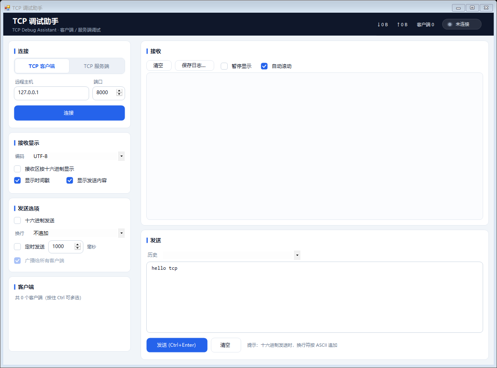
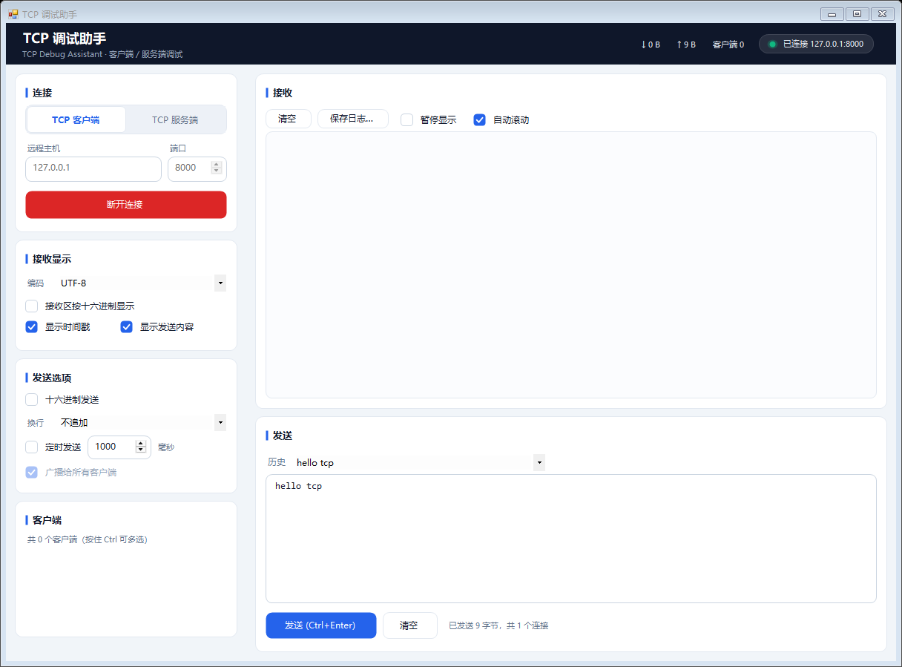

# 用 C# 从零做一个 TCP 调试助手：完整制作过程

这是一份**按真实开发顺序写下来的过程记录**：需求怎么收敛、技术栈为什么是它、网络层怎么绕开常见坑、
界面从"WinForms 默认灰"重做成扁平卡片风、以及在一个**看不到图片**的环境里怎么验证"好不好看"。

成品：一个 Windows 上双击即用的 TCP 调试工具（客户端 / 服务端双模式，文本 + 十六进制，定时发送，
多客户端广播，保存日志），本体 47 KB，零第三方依赖。





---

## 1. 先把"不做什么"定下来

工具类软件最容易做成四不像，所以先划线：

**要做**
- 客户端模式：填主机 + 端口连接，超时给明确错误
- 服务端模式：监听本机端口，多个客户端同时接入，列表里能多选定向发送、也能广播
- 文本（UTF-8 / GBK / ASCII / Latin1）与十六进制双向收发
- 定时发送、发送历史、`Ctrl+Enter` 快捷发送
- 接收区可暂停、自动滚动、可保存日志
- 设置自动记住

**不做**
- 协议解析器 / 报文模板引擎（那是另一类工具）
- 脚本化、插件、跨平台、安装包
- 任何需要额外运行时的东西——「双击即用、零依赖」是硬要求，这条后面直接决定了技术栈

---

## 2. 环境约束反过来定了技术栈

开发这台机器上：**没有 .NET SDK、没有网络**（装不了 NuGet 包，也用不了 `dotnet` / MSBuild / winget）。
但每台 Win10/11 都自带 .NET Framework 4.8 运行时**以及它附带的 C# 编译器**。于是技术栈不是"选"出来的，是"剩"下来的：

| 约束 | 结果 |
|------|------|
| 没有 SDK / MSBuild | 直接用 `C:\Windows\Microsoft.NET\Framework64\v4.0.30319\csc.exe` 编译 |
| 没有网络 → 没有 NuGet | 界面库一个都不能引，WinForms 自带控件里挑，剩下的自己画 |
| 编译器是旧版 | **C# 5 语法上限**，见下表 |
| 要求零依赖、单文件启动 | 目标框架 .NET Framework 4.8（系统自带），`/target:winexe` |

C# 5 意味着这些都不能用（都试过、都报过错）：

| 想用的 | 实际得写成 |
|--------|-----------|
| `$"a{b}"` 字符串插值 | `"a" + b` 或 `string.Format` |
| `x?.Foo` 空引用运算符 | 显式 `if (x != null)` |
| `nameof(x)` | 常量字符串 |
| `public int X { get; set; } = 5;` 自动属性初始化 | 构造函数里赋值 |
| 局部函数、表达式体成员（`=>` 方法体） | 普通私有方法 |
| `async/await` | 语法支持，但这里选了后台阻塞线程（见第 3 节） |

实际编译命令（`build.ps1` 里就是这么调的）：

```powershell
csc.exe /noconfig /codepage:65001 /optimize+ /warn:2 /target:winexe `
        /out:bin\TcpDebugAssistant.exe `
        /win32manifest:src\App\app.manifest `
        /r:System.dll /r:System.Core.dll /r:System.Drawing.dll /r:System.Windows.Forms.dll `
        /r:bin\TcpTool.Core.dll `
        src\App\*.cs
```

`/codepage:65001` 是为了让源码里的中文按 UTF-8 读入；`/win32manifest` 挂上 DPI 感知和 Windows 10/11 兼容声明。

---

## 3. 分层：网络逻辑与界面彻底分开

```
src\Core\     纯网络库，不引用 WinForms
  HexUtil.cs            十六进制解析 / 格式化
  TextCodec.cs          编解码、控制字符转义、跨包增量解码
  TcpEvents.cs          ClientInfo / 事件参数 / 收发统计
  TcpServerSession.cs   服务端：监听、多客户端、定向发送、广播
  TcpClientSession.cs   客户端：连接、超时、收发、断开
src\App\      界面层
  Program.cs            入口 + 全局异常兜底
  Theme.cs              色板 / 字体 / 圆角路径 / 对比度计算
  UiControls.cs         自绘控件
  MainForm.Layout.cs    所有控件在代码里创建与摆放（不用设计器）
  MainForm.Logic.cs     连接 / 收发 / 显示 / 设置
  SettingsStore.cs      %APPDATA% 下的 key=value 配置
tests\core\SelfTest.cs  控制台自检（真实 socket 回环）
tests\gui\GuiHarness.cs 窗体验证
tests\gui-smoke.ps1     端到端 UI 自动化
```

`Core` 不依赖 WinForms 这一点很关键：它让**核心网络逻辑可以用控制台程序测试**（`SelfTest.exe`），
不需要点界面就能验证"服务端能不能接受连接、广播是否到齐、客户端断开是否触发事件"。

---

## 4. 网络层的关键决定

**① 阻塞式 socket + 后台线程，而不是 async**

`async/await` 在 C# 5 里可用，但整个收发模型会变成状态机 + 捕获上下文，调试和错误处理都更绕。
这里每个连接一条后台线程跑阻塞 `Read` 循环，收包后通过事件抛出，界面用 `BeginInvoke` 切回 UI 线程：

```csharp
private void SafeUi(MethodInvoker action)
{
    if (IsDisposed || Disposing) return;
    if (InvokeRequired) { try { BeginInvoke(action); } catch (InvalidOperationException) { } }
    else action();
}
```

窗口关闭期间控件已销毁，`BeginInvoke` 会抛 `InvalidOperationException`/`ObjectDisposedException`——
注意后者是前者的子类，**一个 catch 就够**（写成两个 catch 会 `error CS0160`）。

**② 连接超时**：`BeginConnect` + `AsyncWaitHandle.WaitOne(timeoutMs)`，超时后主动关闭并抛出可读错误，
而不是让用户对着"连接中"发呆。

**③ 多客户端管理**：每个客户端一个 `ClientEntry`，带独立写锁（多个线程广播时不会把字节流写乱）、
以及"断开只通知一次"的 `Interlocked` 标记——否则 `Stop()` 主动关闭引发的异常回调和正常断开回调
会让界面上同一条"已断开"出现两次。

**④ 收包不乱码**：TCP 是字节流，一个 3 字节的汉字完全可能被拆到两个包里。
所以用 `Encoding.GetDecoder()` 做了个增量解码器，按连接各自持有：

```csharp
public sealed class StreamTextDecoder
{
    private Decoder _decoder;      // 保留半个字符的状态
    public string Decode(byte[] data, int offset, int count);
    public void SetEncoding(string name);   // 切换编码时重置状态
}
```

服务端每个客户端一个解码器实例（`Dictionary<long, StreamTextDecoder>`），客户端模式一个；
切换编码时全部重建，避免残留半个字符。

**⑤ 十六进制容错**：`01 0A FF`、`010AFF`、`0x01,0x02`、`01-02`、`01|02`、跨行粘贴都接受；
非法字符和奇数长度给出中文错误提示，而不是静默丢弃。

**⑥ 高频收包不卡界面**：收到的日志先攒进一个片段缓冲，60 ms 的 `Timer` 批量刷进接收区；
超过 200 万字符自动清空并提示（长时间抓包不至于把内存吃满）。

---

## 5. 界面：第一版能用，第二版才像样

**第一版**是标准的 WinForms 拼装：Form + 四个 `GroupBox` + 系统按钮 + 底部 `StatusStrip`。
功能没问题，但视觉上就是"2010 年的内部小工具"：

- 灰底 + 3D 凹陷边框，控件挤在一起，没有层次
- 收发日志同一个颜色，几十行之后分不清哪行是发的
- 客户端/服务端切换是两个灰圆点单选按钮，占地方又不好按
- 状态、计数全塞在底部状态栏，深色日志区旁边一条灰带

**第二版的设计目标**（一句话）：深色信息栏 + 浅灰页面 + 白色圆角卡片 + 一个强调色 + 等宽日志区。


### 5.1 先把颜色收进一个文件

`Theme.cs` 里只有颜色、字体、圆角路径和对比度公式，界面任何地方都不写死色值。
想换主色只改一个常量，全界面跟着变。

```csharp
public static readonly Color WindowBack = Color.FromArgb(241, 245, 249);  // 页面底色
public static readonly Color CardBack   = Color.White;                    // 卡片
public static readonly Color HeaderBack = Color.FromArgb(15, 23, 42);     // 深色信息栏
public static readonly Color Accent     = Color.FromArgb(37, 99, 235);    // 强调色（蓝）
public static readonly Color Danger     = Color.FromArgb(220, 38, 38);    // 断开/停止（红）
public static readonly Color Success    = Color.FromArgb(16, 185, 129);   // 已连接（绿）
```

### 5.2 自绘控件：继承标准控件，只重写 OnPaint

这是一个关键取舍。`UserControl`/`Control` 从零派生的话，键盘、焦点、无障碍、UI 自动化全部要自己实现——
而后面要用 UI 自动化做端到端测试。所以**继承标准控件、只覆盖 `OnPaint`**：

| 自绘控件 | 基类 | 手工处理的外观 |
|---------|------|----------------|
| `CardPanel` | `Panel` | 圆角白卡片 + 1px 描边 + 标题左侧强调竖条 |
| `FlatButton` | `Button` | 三种样式（主操作实心蓝 / 断开停止实心红 / 次要描边），悬停、按下、禁用态 |
| `FlatCheck` | `CheckBox` | 16px 圆角方框，选中填蓝画白勾 |
| `SegmentRadio` | `RadioButton` | 胶囊分段按钮里的一段（选中浮起白底 + 蓝色加粗） |
| `Frame` / `FlatInput` | `Panel` | 圆角描边输入框外框，焦点时边框变蓝 |
| `StatusPill` | `Control` | 顶部状态胶囊，圆点颜色 = 状态，宽度随文字自适应 |
| `ClientListBox` | `ListBox` | 选中行浅蓝底、每行前缀绿点 |

比如"客户端/服务端切换"用的是两个 `RadioButton`，只是把外观画成胶囊的两段：

```csharp
protected override void OnPaint(PaintEventArgs e)
{
    // 选中：画一个白色圆角胶囊；未选中：透明（露出轨道色）；悬停：半透明白
    // 文字：选中时强调色 + 加粗
}
```

这样互斥、键盘方向键、Tab 顺序、无障碍名称全部免费继承，测试脚本也能靠 `RadioButton` 找到它。

### 5.3 日志分色：RichTextBox 分段着色

接收区从 `TextBox` 换成 `RichTextBox`，一个数据包拆成几段，各自上色：

| 片段 | 颜色 |
|------|------|
| `[09:57:51.522]` 时间戳 | 灰 `#64748B` |
| `←` / `→` 方向、`#1` 客户端编号 | 青 `#0F766E` |
| 收到的正文 | 深墨 `#1E293B` |
| 发出的正文 | 蓝 `#1D4ED8` |

```csharp
private void AppendSegment(LogSegment segment)
{
    txtRecv.SelectionStart = txtRecv.TextLength;
    txtRecv.SelectionLength = 0;
    txtRecv.SelectionColor = segment.Color;
    txtRecv.AppendText(segment.Text);
}
```

仍然走 60 ms 批量刷新：一次刷一批片段，不会因为"逐段改颜色"而卡。

### 5.4 状态与操作的颜色语言

- 顶部胶囊圆点：灰（未连接）→ 橙（连接中/客户端断开）→ 绿（已连接/监听中）
- 主按钮：未连接时是蓝色「连接 / 开始监听」，连上后立刻变成红色「断开连接 / 停止监听」——
  状态和"下一步该点哪"用颜色绑在一起，不用读文字
- 输入框获得焦点时边框变蓝，失焦恢复灰；按钮有悬停和按下反馈
- 页面底色当作"留白"：左侧卡片之间、接收区和发送区之间的分隔条都是页面底色，不再画分割线

### 5.5 DPI 与布局

- `AutoScaleMode.Font` + manifest 里 `dpiAware true`
- 左侧卡片用 `FlowLayoutPanel` 竖排，右侧用 `SplitContainer` 上下分（默认约 58% / 42%）
- **分割条位置必须在 `OnLoad` 里算**：构造期容器还没有真实尺寸，提前设置 `SplitterDistance`
  会直接抛异常（见下一节）

---

## 6. 踩坑与修复

| 现象 | 根因 | 修法 |
|------|------|------|
| 程序一启动就弹「程序错误」对话框 | `InitializeComponent` 里设置 `SplitterDistance` 时容器还没有真实尺寸，抛 `SplitterDistance 必须在 Panel1MinSize 和 Width - Panel2MinSize 之间` | 把 `SplitterDistance`/`PanelXxxMinSize` 全部移到 `OnLoad`：先设 MinSize，再按高度比例夹取，外面再包 try/catch |
| `error CS0160`：前一个 catch 子句已经处理了该类型 | `catch (ObjectDisposedException)` 写在 `catch (InvalidOperationException)` 之后，而前者是后者的子类 | 合并成一个 catch |
| `error CS0016`：未能写入输出文件，正由另一进程使用 | 上次调试残留的窗口进程锁住了 `bin\TcpTool.Core.dll` | `build.ps1` 编译前先结束同名残留进程 |
| 构建脚本报「必须在"/"运算符后面提供一个值表达式」、中文全乱 | PowerShell 5.1 把无 BOM 的 `.ps1` 按 ANSI 读，中文注释被截断 | 带中文的 `.ps1` 必须**存成 UTF-8 with BOM** |
| 脚本里中文引号导致解析失败 | 智能引号 `“ ”` 在 PowerShell 里被当成字符串分隔符 | 文档/注释里改用 `「」` |
| `error CS2001: 未能找到源文件 "C"` | 函数返回"单元素数组"时被 PowerShell 展开成标量，splat 时按字符拆了路径 | 函数内 `[string[]]@(...)`，调用处 `$x = @(Get-Sources ...)` |
| 从脚本启动 GUI 时命令卡住两分钟 | `Start-Process`/ShellExecute 启动的子进程继承了 stdout 管道，管道不关就不返回 | 用 `[System.Diagnostics.Process]::Start()` 且 `UseShellExecute = $false` |
| UI 自动化找不到接收区里的文字 | 只读多行 `TextBox`（现在是 `RichTextBox`）在 UIA 里是 `Document` 而不是 `Edit` | 遍历所有后代元素，先试 `ValuePattern` 再试 `TextPattern`，并给 3 秒宽限 |
| 编译报「`RadioButton` 未包含 `RoundLeft` 的定义」 | 字段声明成基类 `RadioButton`，自绘子类的新成员不可见 | 字段用派生类型（`SegmentRadio` / `FlatButton`）声明 |
| 改了界面默认值后，行为悄悄变了（发送回显默认关闭） | 设置的"默认值"取的是控件当时的 `Checked`，控件初始状态一变，默认值跟着变 | 默认值在布局里显式设定，测试前删掉已保存的 `settings.ini`，保证每次从干净状态跑 |

最后一条其实是设计问题，不是语法问题：**默认值不要寄生在控件状态上**。

---

## 7. 没有"眼睛"怎么验证界面好看

这次开发的特殊之处：改界面的这个模型**看不到图片**。截图只能给人看，没法自己判断"好不好看"。
于是把"好看"里**可以量化**的部分全部变成断言，让构建来替我盯：

### ① 结构断言

控件树里必须存在：只读 RichTextBox（接收区，Consolas）、多行 TextBox（发送区）、
`SplitContainer`、`StatusPill`、6 张卡片、2 个分段单选、5 个扁平按钮……

### ② 布局断言

- 每个控件换算到窗体坐标后必须落在窗体内
- 没 `Dock` 的控件必须被父容器完整包含（**被裁切**说明尺寸算法有问题）
- 左侧卡片自上而下不得重叠，且总高度不得超过视口（否则会出现滚动条）
- 接收区高度 ≥ 200 px、发送区 ≥ 110 px

这一条在改版中救过一次场：一张卡片的标题标签宽度写成 120，卡片只有 300 宽、标签 x=206，
直接溢出被裁切 —— 断言当场报出来。

### ③ 渲染像素断言（代替眼睛看截图）

用 `Form.DrawToBitmap` 把窗口渲染成位图，再按色板做统计：

```csharp
// 采样步长 3 像素，只统计客户区
if (SameColor(pixel, Theme.CardBack))   white++;
else if (SameColor(pixel, Theme.WindowBack)) windowBack++;
else if (SameColor(pixel, Theme.LogBack))    logBack++;
else if (SameColor(pixel, Theme.HeaderBack)) headerDark++;
else if (SameColor(pixel, Theme.Accent) || SameColor(pixel, Theme.Danger)) accent++;

// 系统默认控件灰（#F0F0F0）出现 = 还有没换皮肤的地方
if (pixel.R == 240 && pixel.G == 240 && pixel.B == 240) legacyGray++;
```

实测输出（构建里就是这些数字）：

```
像素分布：白 50.1%，页面底色 8.7%，日志底色 28.6%，深色标题栏 6.3%，强调色 1.45%
标题栏中部平均亮度：26
系统默认灰像素：156 个采样（区域 y 217..634，占客户区 0.14%）
卡片圆角：角点=#F1F5F9 内部=#FFFFFF
```

四条断言的含义：
- 白色 ≥ 15% → 卡片样式确实生效了（没有退化回灰底）
- 页面底色 ≥ 3%、日志底色 ≥ 3% → 层次还在
- 标题栏中部平均亮度 < 60 → 深色栏真的画出来了（这条一开始失败过：`DrawToBitmap` 会把标题栏
  以上的非客户区也画进位图，采样落到了窗口标题栏上，平均亮度 139。改成先算客户区偏移 `(8,31)` 再采样才对）
- 系统默认灰 < 2% → 没有漏掉换肤的控件（实测剩下的 0.14% 全是系统自绘的滚动条）

**圆角也要证明**：取卡片左上角 1px 处和向内 12px 处两个像素——前者应该是页面底色（圆角让位），
后者应该是白色。`角点=#F1F5F9 内部=#FFFFFF` 说明圆角确实画出来了，而不是一段白方块。

### ④ 对比度断言（防止"好看但看不清"）

`Theme.ContrastRatio` 用 WCAG 公式算相对亮度，构建时逐对检查 11 组前景/背景：

```
对比度 日志正文：14.25:1（要求 ≥ 7.0）
对比度 日志-发送内容：6.53:1（要求 ≥ 4.5）
对比度 日志-时间戳：4.64:1（要求 ≥ 4.5）
对比度 日志-客户端编号：5.33:1（要求 ≥ 4.5）
对比度 卡片标题：17.85:1（要求 ≥ 7.0）
对比度 次要文字：4.76:1（要求 ≥ 4.5）
对比度 主按钮文字：5.17:1（要求 ≥ 4.5）
对比度 危险按钮文字：4.83:1（要求 ≥ 4.5）
对比度 标题栏副标题：6.96:1（要求 ≥ 4.5）
```

改色时这条最有用：一开始挑的红是 `#EF4444`，白字对比度只有 3.76:1，不达标，换成 `#DC2626` 才过。
时间戳最初想用很浅的 `#94A3B8`（2.57:1），也换成了 `#64748B`。

### ⑤ 状态样式也验证

在两张渲染图里按颜色找区域：**待机图里不该有红色**，**已连接图里红色只应出现在主按钮那一块**
（实测 `x 36..304, y 258..292`，正好是那张 272×38 的按钮），绿色只应出现在状态胶囊的圆点上。

> 诚实的边界：这些断言能保证"没有退化、层次还在、字看得清、状态色正确"，
> 但**审美本身没法自动化**。所以仓库里仍然存了渲染图，最后一步还是人扫一眼。

---

## 8. 测试矩阵

一次 `build.ps1 -FullTest` 跑完五套（全部真实执行，失败即中断）：

| 测试 | 覆盖 |
|------|------|
| `SelfTest.exe` | 18 项：十六进制解析/格式化往返、UTF-8/GBK 编解码、控制字符转义、多字节字符拆包不乱码、统计线程安全、服务端接受连接·定向回发·双客户端广播·停止后清空、客户端连接·收发·断开、连接被拒抛错 |
| `GuiHarness.exe` | 65 个控件结构断言 + 布局断言（不越界/不裁切/卡片不重叠）+ 渲染像素与圆角 + 11 组对比度 |
| `GuiHarness.exe --interactive` | 客户端模式：点「连接」→ 真实建立 TCP → 点「发送」→ 对端收到 9 字节 → 接收区出现回显 |
| `GuiHarness.exe --server` | 服务端模式：点「开始监听」→ 外部客户端进列表 → 广播到达 → 收到对端数据 → 停止后列表清空 |
| `tests\gui-smoke.ps1` | 独立 exe 的端到端：UI 自动化点击真实按钮，校验回显，并截图 |

真实输出（节选）：

```
[通过] 服务端：多客户端广播
[通过] 客户端会话：连接、发送、接收、断开事件
通过 18 项，失败 0 项

控件总数：65
扁平按钮 5，输入框 5，自绘复选 8，下拉 3，标签 13，列表 1，分段单选 2，卡片 6，状态胶囊 1，标题栏 1
接收区内容：[09:57:51.310] → hello tcp
             [09:57:51.522] ← #1 ping-from-peer
界面冒烟测试全部通过。
```

---

## 9. 怎么构建和运行

需要：Windows 10/11（自带 .NET Framework 4.8），**不需要装 .NET SDK**。

```powershell
# 编译 + 自检
powershell -ExecutionPolicy Bypass -File build.ps1

# 编译 + 自检 + 启动界面
powershell -ExecutionPolicy Bypass -File build.ps1 -Run

# 全量验证（会短暂弹窗、占用 8000 端口）
powershell -ExecutionPolicy Bypass -File build.ps1 -FullTest
```

产物在 `bin\`，直接双击 `bin\TcpDebugAssistant.exe` 就能用。

自己跟自己试一遍：一个实例选「TCP 服务端」端口 8000 点「开始监听」，另一个选「TCP 客户端」
连 `127.0.0.1:8000`，点「发送」，服务端窗口就会出现 `[时间] ← #1 hello tcp`。

---

## 10. 回看：几条值得记下来的原则

1. **约束先算清，方案自然收敛**。没有 SDK、没有网络这一条，直接决定了 csc + WinForms + 自绘，
   省掉了后来所有的"要不要引个 UI 库"的犹豫。
2. **核心逻辑和界面分开，测试才有落点**。`Core` 不引用 WinForms，才可能用控制台程序验证网络行为。
3. **自绘要继承标准控件**。为了好看从 `Control` 派生，会连带丢掉键盘、焦点、无障碍和 UI 自动化——
   而 UI 自动化正是端到端测试的手。
4. **好看里能量化的部分，全部变成断言**。像素分布、对比度、圆角、裁切，这些都能在构建里自动守住。
5. **默认值不要寄生在控件状态上**。设置项的默认值一旦取"控件当前值"，改界面就等于悄悄改行为。

---

*技术栈：C# 5 / .NET Framework 4.8 / WinForms，全代码布局与自绘控件，零第三方依赖。*
